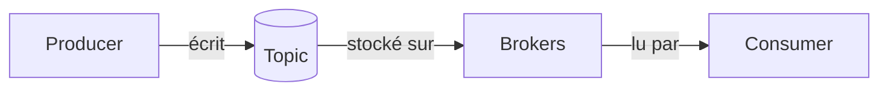
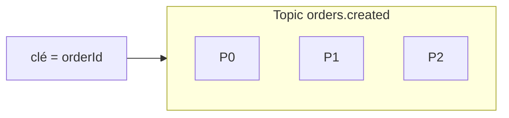
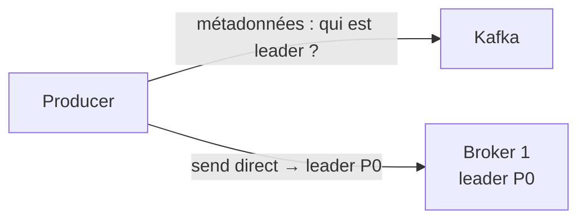
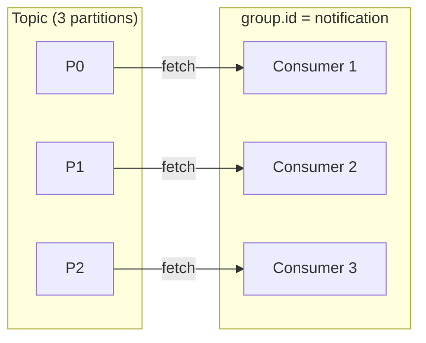
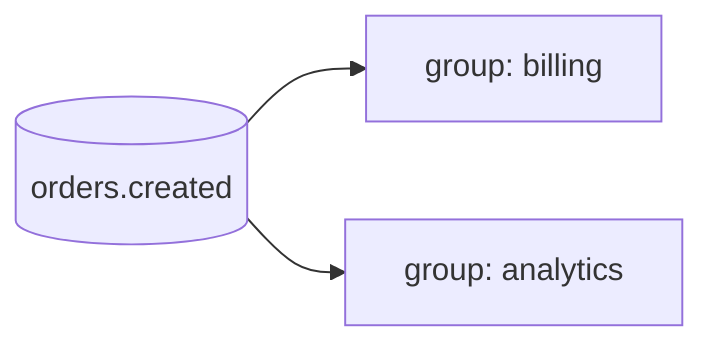
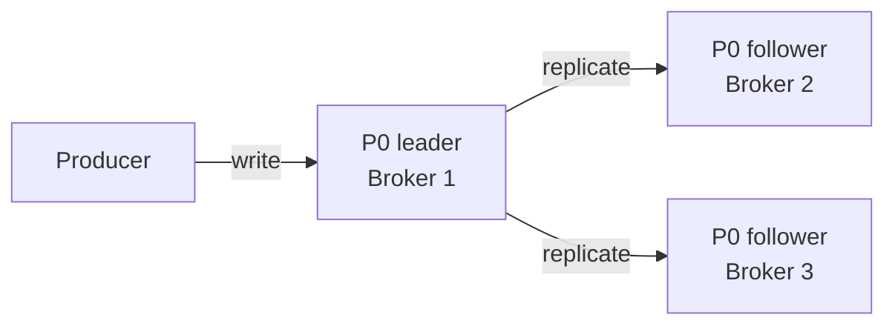
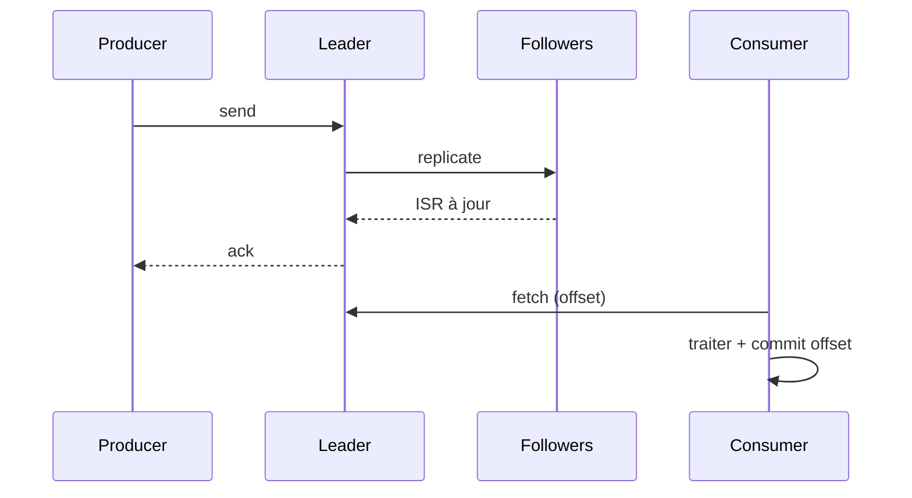

# Architecture Kafka — l'essentiel

Explication courte et orientée application des concepts Kafka : producers, topics, brokers, consumer groups, réplication et KRaft — sans jargon inutile.

**Source / inspiration :** [Apache Kafka Architecture Diagram: Producers, Brokers, KRaft Controllers and Consumer Groups](https://bytediagram.com/blog/apache-kafka-architecture-diagram-kraft-brokers-consumer-groups.html) (ByteDiagram).

---

## Kafka en une phrase

Kafka, c’est une **file de messages persistante et distribuée** : tu publies des événements, d’autres services les lisent quand ils veulent, **sans que l’émetteur et le récepteur se connaissent**.

Pense à un **journal append-only partagé** : on écrit à la fin, on lit à son rythme. Ce n’est ni une base de données relationnelle, ni une queue type Redis qui disparaît dès qu’on l’a lue.

---

## Les 4 pièces (côté application)

| Pièce | Rôle |
| --- | --- |
| **Producer** | Le service qui **écrit** un événement (ex. `order-service` publie `orders.created`). |
| **Topic** (+ partitions) | Le **canal nommé** où vivent les messages d’un même type d’événement. |
| **Broker** | Les machines du cluster Kafka qui **stockent** et servent les données. |
| **Consumer** (groupe) | Le service qui **lit et traite** les événements. |

Les **KRaft controllers** gèrent le cluster (métadonnées, élection de leaders, etc.). Côté appli, tu touches surtout à `bootstrap.servers` : le reste est de l’infra.

Producer et consumer ne se connaissent pas : Kafka fait le tampon.

---

## Topics et partitions

- Un **topic** = un type d’événements (`orders.created`, `payments.processed`…).
- Les **partitions** = des tuyaux parallèles à l’intérieur du topic.
- L’**ordre est garanti seulement dans une partition**, pas sur tout le topic.
- La **même clé** (ex. `orderId`) envoie toujours le message vers la **même partition** → ordre métier cohérent pour une même entité.
- **Plus de partitions ≈ plus de parallélisme** côté consumers (dans la limite du nombre d’instances du groupe).

En pratique : choisis une clé métier stable quand l’ordre par entité compte ; dimensionne le nombre de partitions selon le débit et le parallélisme souhaités.

---

## Producer (configs utiles)

Le producer n’envoie **pas** les messages aux consumers : il les écrit dans Kafka. Les consumers viennent les chercher.

Configs souvent utiles :

- **`acks`** (**ack** = *acknowledgment* / acquittement : confirmation que le message a bien été reçu) : `all` (attendre les replicas), `1` (leader seul), `0` (fire-and-forget). En prod, `acks=all` est le choix le plus sûr avec une bonne config de réplication.
- **Clé de partition** : pour coller l’ordre métier à une partition.
- **Idempotence** (`enable.idempotence=true`) : limite les doublons côté producer en cas de retry.

Le producer résout le **leader** de la partition cible, puis envoie **directement** à ce broker.

---

## Consumer group

- Plusieurs instances avec le **même `group.id`** = un seul **groupe de consumers**.
- Règle clé : **1 partition ↔ au plus 1 consumer du groupe** à un instant donné.
- L’**offset** = la position de lecture (« j’en suis au message #42 de cette partition »).
- Modèle **pull** : le consumer **fetch** les messages ; Kafka ne les pousse pas.
- Le **lag** = combien de messages restent derrière le consumer (indicateur de santé / charge).

Si tu as 3 partitions et 1 instance : une instance lit les 3. Si tu as 3 instances : chacune prend en général 1 partition. Une 4ᵉ instance reste inactive tant qu’il n’y a pas plus de partitions.

### Cas d’usage

- **Scaler un traitement métier** : plusieurs **instances** du même service partagent le même `group.id` → les partitions sont réparties entre elles, chaque message est traité **une fois** par ce service ; si une instance tombe, un **rebalance** redistribue ses partitions.
- **Plusieurs métiers sur le même topic** : un `group.id` **différent** par service (ex. facturation vs analytics) → chaque groupe reçoit le **flux complet**, avec ses **propres offsets**.

---

## Réplication et ISR (court)

- Chaque partition a un **leader** et des **followers** (replicas).
- L’**ISR** (*In-Sync Replicas*) = les replicas à jour avec le leader.
- Un message est **committed** quand il est accepté par suffisamment de replicas (selon la config).
- Combo typique en prod : **`acks=all`** + **`min.insync.replicas`** ≥ 2 → tu n’ack qu’avec une vraie durabilité.

Sans ça, tu peux perdre des messages en cas de panne du leader juste après un ack trop optimiste. Seuls les membres de l’**ISR** peuvent devenir leader.

---

## Parcours d’un message

1. Le producer récupère les **métadonnées** et trouve le **leader** de la partition.
2. La **clé** (ou round-robin) choisit la **partition**.
3. **Send** vers le leader.
4. Le leader **réplique** vers les followers.
5. Le message est **committed** une fois assez de replicas à jour.
6. Le producer reçoit l’**ack**.
7. Le consumer **fetch** les messages committed.
8. Après traitement, le consumer **commit l’offset**.

Kafka offre en pratique du **at-least-once** côté consommation si tu commits après traitement : en cas de crash entre traitement et commit, tu peux retraiter. D’où l’intérêt d’**handlers idempotents** (ou d’un outbox / table de déduplication).

---

## KRaft (métadonnées du cluster)

**KRaft** est le mode où Kafka gère lui-même les **métadonnées du cluster** (topics, partitions, leaders, membership) via des **controllers** dédiés. Avant Kafka 4.0 / avant KRaft par défaut, le cluster s’appuyait sur un ensemble **ZooKeeper** séparé pour la coordination et les métadonnées — d’où sa présence dans les docs et stacks plus anciennes. Côté backend, tu ne configures pas KRaft : c’est l’infra (Docker Compose, ops). Ton code client reste le même — `bootstrap.servers`, topics, `group.id`, produce / consume.

---

## Checklist backend

1. Quel **événement** / quel **topic** ?
2. Quelle **clé** de partition (ordre métier) ?
3. Quel **`group.id`** (et qui partage le même) ?
4. Combien d’**instances** vs combien de **partitions** ?
5. **Idempotence** producer + handlers idempotents ?
6. Gestion d’**erreurs** / retry / **DLQ** ?
7. Suivi du **lag** en prod ?

---

## Analogie (pour retenir)

| Concept Kafka | Analogie |
| --- | --- |
| Topic | Canal Slack |
| Partition | Fil de discussion parallèle |
| Producer | Quelqu’un qui poste un message |
| Consumer group | Une équipe : **un lecteur par fil** |
| Offset | « Lu jusqu’au message #42 » |
| Réplication | Message sauvegardé sur plusieurs serveurs |

Kafka reste le journal partagé : tout le monde lit le même historique, chacun à son rythme, sans appeler directement le service voisin.
